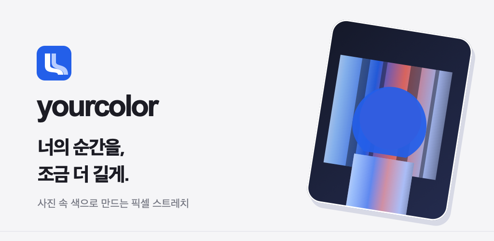
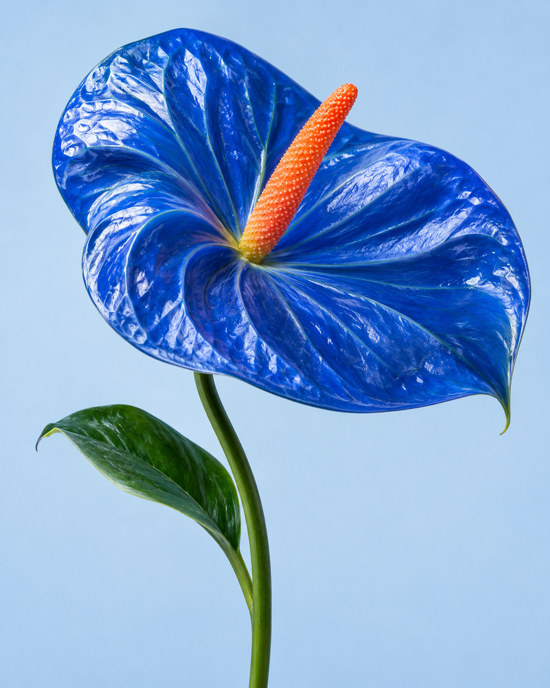
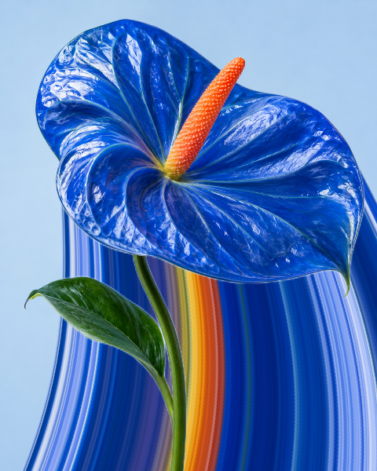
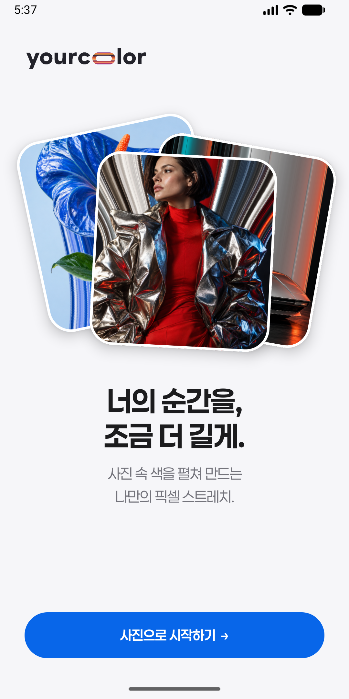
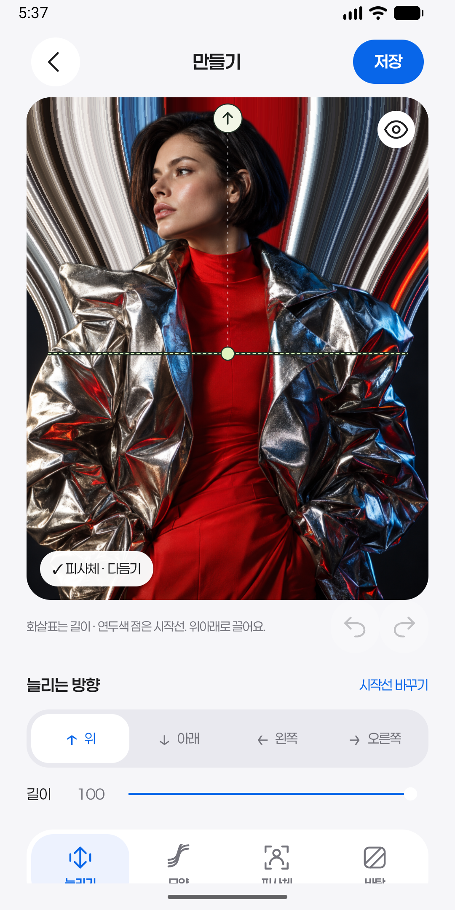
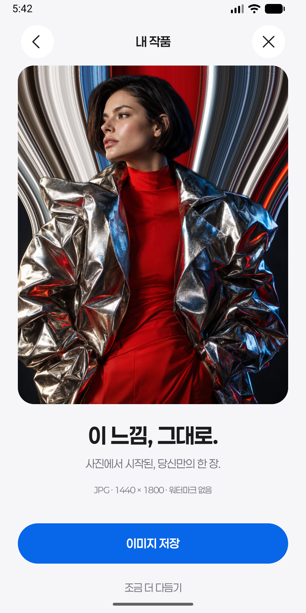

# yourcolor

  <strong>너의 순간을, 조금 더 길게.</strong> 
  사진 속 색을 펼쳐 만드는 픽셀 스트레치 에디터

  

## 사진 속 색을 펼치면

| 원본 샘플 | yourcolor 결과 |
| :---: | :---: |
|  |  |

피사체는 앱이 찾고, <strong>방향·길이·모양은 내가 정합니다.</strong>

## 앱에서 만들기

| 01 · 사진 선택 | 02 · 직접 편집 | 03 · JPG 저장 |
| :---: | :---: | :---: |
|  |  |  |

- **직접 조절** — 위·아래·왼쪽·오른쪽, 직선·펼침·곡선, 길이·시작선·배경.
- **세밀한 마무리** — 피사체 경계를 브러시로 다듬고, 원본을 보존한 채 워터마크 없는 JPG로 저장.
- **기기에서 처리** — 피사체 분리와 편집은 오프라인으로 실행. 계정이나 서버 연결 없이 사용.

## 실행하기

**Android Studio**에서 [`android/`](android) 폴더를 열고, Gradle 동기화 후 `app`을 실행하세요. Android 7.0 이상을 지원합니다. 개발 환경과 기능·검증 범위는 [Android 실행 안내](android/README.md)에 정리되어 있습니다.

## Google Play

현재 [Google Play에 공개된 앱](https://play.google.com/store/apps/details?id=com.robotics.yourcolor)은 이전 퍼스널 컬러 진단 버전입니다. 이 README에서 소개한 픽셀 스트레치 앱은 아직 출시 준비 중입니다.

## 히스토리

이 저장소는 2022년 AI 퍼스널 컬러 진단 웹 서비스 「**너의 퍼스널 컬러는**」에서 시작했습니다. 원래 웹 버전은 [`index.html`](index.html)에 남아 있으며, 현재는 Android 사진 편집 앱을 중심으로 개발하고 있습니다.
