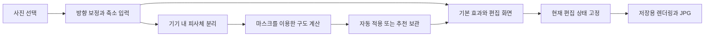

# YourColor 첫 버전 상세 설계

> **2026-10-10 후속 결정:** 사용자가 자동 구도 생성 방향을 폐기했다. 현재는 색선을 직접 고르고 자유롭게 워프하는 수동 편집을 우선한다. 아래 자동 생성 관련 설계는 이전 안이며, 최신 HTML 시안과 구현 범위는 [디자인 시안 02](../design-prototypes/README.md)를 따른다. 네이티브 반영과 최종 글꼴은 아직 확정하지 않았다.

2026년 10월 10일. 사진 한 장을 넣으면 픽셀 스트레치 결과를 자동으로 만들고, 같은 화면에서 조정한 뒤 저장하는 안드로이드 앱을 설계한다. 자동 결과를 기다리는 동안에도 기본 편집을 할 수 있고, 사용자가 수정한 내용은 뒤늦은 추천으로 바뀌지 않게 한다.

사용자는 통합 편집 흐름과 설계 진행에 이어 **네이티브 프로젝트 준비·핵심 흐름 구현을 승인했다.** `android/`에 검증 앱을 구현했으며 [실행 안내](../../android/README.md)에 실제 구성과 검증 범위를 기록한다. 이 문서의 성능 수치는 목표이며 출시 범위·스토어 공개 승인을 뜻하지 않는다. 상위 조건은 [리빌딩 기획](pixel-stretch-brief.md), 추가 기능 선택지는 [기능 목록](v1-features-and-wireframes.md)을 따른다.

**설계 범위**

| 구분 | 내용 |
| --- | --- |
| 선택한 경험 | 사진 선택 → 자동 결과와 직접 조정 → 저장 |
| 필수 조건 | 안드로이드 네이티브, 사진의 기기 내 처리, 자체 백엔드 없음, 사용량 API 요금 없음 |
| 핵심 설계안 | 사진 한 장, 효과 한 개, 자동 피사체 분리, 초기 구도 추천, 직선·아치·S자, 길이·방향·휘어짐·색선 조정, 원본 비교, 실행 취소·다시 실행, JPG 저장·공유 |
| 품질 보완 제안 | 수동 복원 브러시, 효과 강도와 끝 흐리기. 먼저 핵심 흐름을 검증한 뒤 포함 여부를 정한다. |
| 후속 검토 | 영상, 여러 레이어, 출력 비율 변경, 편집 프로젝트 목록, 색상 팔레트 카드 |
| 선택적 기기 목표 | LG V20. 미지원이나 속도 부족만으로 전체 출시를 중단하지 않는다. |

초기 품질 검증은 피사체 하나가 뚜렷한 사진에 집중하는 것을 제안한다. 여러 사람, 머리카락과 비슷한 배경, 피사체 없는 풍경도 실패 대응을 확인하기 위해 포함한다. 자동으로 예쁜 결과가 나온다는 보장은 하지 않는다.

**사용자가 선택한 시각적 방향**

사용자가 첨부한 사진 컬렉션 앱 이미지를 기준으로, 밝고 정돈된 화면에 사진 자체의 색과 조형이 돋보이는 방향을 선택했다. 넉넉한 여백, 큰 둥근 모서리, 겹쳐진 사진 카드, 부드러운 그림자, 간결한 검정 글자와 선명한 주요 버튼이 기준이다. 아래 화면별 적용 방식과 세부 수치는 디자인 제안이다.

| 요소 | YourColor 적용안 |
| --- | --- |
| 배경과 색 | 밝은 회색 또는 미색을 기본 배경으로 하고 도구는 흰색 표면에 배치한다. 포인트 색은 한 가지로 제한하고 작품의 색이 중심이 되게 한다. |
| 시작 화면 | 스트레치 결과 예시 2~3장을 살짝 겹친 카드로 표현한다. 짧은 소개와 사진 선택 버튼에 집중한다. |
| 편집 화면 | 큰 사진 영역 아래에 둥근 도구 패널과 간결한 슬라이더를 둔다. 실제 편집 사진은 기울이지 않고 구도와 조절점을 정확히 볼 수 있게 한다. |
| 저장 화면 | 완성한 결과를 큰 카드 한 장으로 보여 주고 저장·공유를 바로 찾을 수 있게 한다. |
| 타이포그래피 | 읽기 쉬운 한글 산세리프, 짧은 제목, 명확한 본문 대비를 사용한다. 글자를 이미지로 만들지 않는다. |
| 형태와 깊이 | 카드 모서리 24~32dp, 넉넉한 간격, 약한 그림자를 초기 후보로 둔다. 조작 영역은 최소 48dp를 설계 기준으로 삼는다. |
| 움직임과 반투명 효과 | 카드 선택과 편집 상태 변화에 짧은 전환을 제안한다. 사진·효과 미리보기 반응성을 우선하고, 흐린 유리 효과는 실제 성능을 확인한 뒤 적용한다. |

예시 사진의 겹침과 그림자는 화면 장식이다. 저장되는 JPG에 카드 테두리·그림자·도구를 함께 넣지 않는다. Android 상태바, 화면 가장자리 여백과 시스템 뒤로가기에 맞춰 구성한다. 프로필·컬렉션 공유 같은 참고 이미지의 서비스 기능은 이번 앱의 개발 범위로 추가하지 않는다.

**화면과 조작**

화면은 시작, 편집, 저장의 세 개다. 구도 선택만을 위한 중간 화면은 두지 않는다. 편집 화면의 사진 영역과 조절 도구는 화면 크기에 맞게 재배치하고, 작은 화면에서도 저장과 현재 조절값에 접근할 수 있게 한다.

| 화면 | 구성과 동작 | 돌아가기와 예외 |
| --- | --- | --- |
| 시작 | 겹친 결과 예시 카드, 사진 선택, 간단한 처리 안내와 개인정보 안내 진입 | 사진 선택 취소는 시작 화면으로 돌아온다. 회원가입과 촬영 기능은 기본안에 넣지 않는다. |
| 편집 | 위에 실행 취소·다시 실행·저장, 가운데 사진과 원본 비교, 아래 구도 3개와 길이·휘어짐·색선 조절 | 사진 교체나 나가기로 작업을 버릴 때만 확인한다. 자동 분리 실패는 편집 화면을 닫지 않는다. |
| 저장 | 현재 편집의 미리보기, 실제 출력 크기, 이미지 저장과 공유 | 취소하면 같은 편집으로 돌아간다. 쓰기 실패 시 원인을 안내하고 재시도한다. |

기본 편집은 슬라이더만으로 가능하게 한다. 사진 위 색선을 끌면 위치를 바꾸고 양 끝 조절점으로 기울기와 길이를 바꾼다. 늘릴 방향은 좌·우·위·아래에서 고른다. 확대·이동은 두 손가락 조작으로 구분하며, 확대 상태는 저장 구도를 바꾸지 않는다. 접근성을 위해 직접 끌기와 같은 동작을 조절 도구에서도 제공한다.

직선은 휘어짐 조절을 비활성화하고 이유를 표시한다. 아치와 S자는 형태를 선택한 뒤 휘어짐을 조절한다. 다른 구도 선택은 현재 효과를 교체하는 한 번의 편집이며 실행 취소할 수 있다. 슬라이더나 조절점을 누르고 놓기까지의 연속 변경도 실행 취소 한 단계로 묶는다. 원본 비교는 표시만 바꾸며 편집 이력이나 저장 결과를 바꾸지 않는다.

피사체 분리가 준비되면 ‘피사체를 앞으로’ 스위치를 쓸 수 있다. 끄면 원본 위에 스트레치만 합성한다. 브러시를 포함한다면 별도 피사체 도구에서 복원·제외·크기를 제공하고, 각 획을 실행 취소할 수 있게 한다. 브러시의 선택 여부 때문에 핵심 편집 화면의 구성이 달라지지 않도록 한다.

**자동 결과를 만드는 방법**

사진을 새로 그리는 생성형 모델은 사용하지 않는 안이다. AI는 피사체 영역을 나타내는 마스크를 얻는 데 사용하고, 구도는 단순한 규칙과 곡선 계산으로 정한다. 다음 규칙은 구현할 초기 후보이며 사진으로 평가한 뒤 조정한다.

1. 사진 방향을 바로잡고 미리보기와 분리용 입력을 만든다. 원본 전체를 고해상도 비트맵으로 먼저 펼치지 않는다.
2. 축소 사진과 기본 스트레치 효과를 표시한다. 자동 준비 여부와 무관하게 편집을 시작할 수 있게 한다.
3. 피사체 분리를 한 번 실행한다. 원본에 맞춰 매핑할 수 있는 마스크와 피사체 위치를 보관한다.
4. 주된 피사체 주변에서 여백이 큰 방향을 찾고, 피사체를 가로지르는 색선의 초기 위치를 정한다. 여백에 맞춘 아치를 우선 후보로, 여백이 좁으면 짧은 직선을 대안으로 평가한다.
5. 원본 색선에서 가져온 색을 정해진 곡선을 따라 늘리고, 마스크 영역의 원본 피사체를 위에 합성한다. 추천 결과 한 개를 보여 주며 다른 구도는 요청 시 같은 마스크로 만든다.

사람이나 사물이 너무 작거나 피사체가 사실상 화면 전체를 차지하면 사진에 맞춘 추천을 성공했다고 표시하지 않는다. 분리가 애매하거나 비어 있어도 기본 효과와 수동 편집은 제공한다. 이 판단의 면적 기준은 사진별 누끼·구도 평가로 정하고, SDK의 픽셀별 마스크 값을 전체 결과의 ‘정확도 점수’처럼 보여 주지 않는다.

같은 마스크와 조절값에는 같은 효과를 그리도록 구도 규칙을 고정한다. 후보가 동률이면 정해진 순서로 고르고 기본 동작에 무작위 선택을 넣지 않는다. 모델이나 앱 버전이 바뀌어도 AI 마스크가 항상 동일하다고 약속하지는 않는다.

**대기와 편집이 겹칠 때의 규칙**

사진 준비 상태, 자동 분석 상태, 사용자 편집 상태, 저장 상태를 따로 관리한다. 자동 분석이 대기 중이라는 이유로 전체 화면의 버튼을 막지 않는다.

| 상황 | 적용 규칙 | 화면 안내 예시 |
| --- | --- | --- |
| 사진 읽기 전 | 사진 준비 중 표시. 잘못된 파일이면 다시 선택하게 한다. | 사진을 여는 중이에요. |
| 사진 준비 완료, 자동 분석 중 | 기본 효과와 편집 도구를 제공한다. 가짜 진행률을 표시하지 않는다. | 사진에 맞는 구도를 준비 중이에요. 먼저 조정할 수 있어요. |
| 아직 수정하지 않았고 추천 완료 | 마스크와 구도를 한 번에 적용한다. 원래 기본 효과로 실행 취소할 수 있게 한다. | 자동 구도를 만들었어요. |
| 사용자가 먼저 수정했고 추천 완료 | 마스크 스위치까지 포함해 현재 상태를 유지한다. 추천 적용을 눌러야 교체한다. | 추천이 준비됐어요. 지금 편집은 그대로예요. |
| 모델 없음 | 준비 동작과 기본 편집을 제공한다. 다운로드 완료를 기다리게 강제하지 않는다. | 자동 편집 도구를 준비해야 해요. 기본 편집은 바로 가능해요. |
| 분리 실패 또는 피사체 없음 | 재시도와 기본 편집을 제공한다. 이미 있던 정상 결과는 지우지 않는다. | 피사체를 찾지 못했어요. 직접 조정해 보세요. |
| 저장 화면 진입 후 추천 도착 | 저장할 편집 상태를 고정한다. 추천은 보관만 하고 저장 화면을 바꾸지 않는다. | 현재 보이는 편집 결과를 저장해요. |
| 다른 사진을 열었는데 이전 결과 도착 | 사진 식별자가 맞지 않는 결과를 버린다. | 별도 안내 없음 |

사용자가 효과에 손댄 기록은 실행 취소로 지우지 않는다. 기본 효과까지 되돌렸더라도 늦은 자동 결과가 갑자기 적용되지 않게 하기 위해서다. 확대·이동·원본 비교는 효과 수정으로 보지 않는다. 분리 결과가 뒤늦게 생긴 뒤 사용자가 피사체 스위치만 켜면, 구도는 유지하고 마스크만 적용한다.

추천 적용은 구도와 마스크를 함께 교체하는 하나의 편집 명령으로 취급한다. 실행 취소 시 이전 구도와 피사체 상태로 돌아간다. 저장 화면에서 돌아온 경우에도 도착해 있던 추천은 버튼으로만 제안한다.

**기술 구조 제안**

Android 프로젝트 하나와 앱 모듈 하나로 시작한다. 저장소에는 기존 웹을 보존하고, 구현 착수 시 새 네이티브 프로젝트를 별도 디렉터리에 둔다. 서버, 사용자 계정, 원격 설정과 별도 모델 학습 파이프라인은 기본안에 넣지 않는다.

| 역할 | 우선 후보 | 설계 원칙 |
| --- | --- | --- |
| 네이티브 UI와 상태 | Kotlin, AndroidX ViewModel, Android Views | 초기 검증은 Views와 GLSurfaceView로 구성하는 안을 제안한다. UI와 이미지 처리 상태를 분리한다. |
| 사진 읽기 | AndroidX PickVisualMedia, URI 기반 읽기 | 선택한 사진에만 접근한다. EXIF 방향·반전을 미리보기와 저장에 동일하게 반영한다. |
| 피사체 분리 | ML Kit Subject Segmentation | 전경 마스크만 우선 요청한다. 개별 피사체 비트맵 등 쓰지 않는 출력은 만들지 않는다. |
| 구도 계산 | Kotlin의 고정 규칙과 곡선 계산 | 분리 SDK에 종속되지 않게 마스크와 위치 정보만 입력받는다. |
| 효과 합성 | Canvas.drawBitmapMesh, 네이티브 View | 검증 앱에서는 OpenGL ES 제안을 단순화했다. 동일 렌더러가 하드웨어 Canvas 미리보기와 비트맵 JPG 출력을 담당한다. |
| 저장·공유 | JPG, MediaStore 또는 시스템 파일 저장, Android 공유 시트 | 원본은 덮어쓰지 않는다. 완성된 파일만 외부 앱에 공유한다. |
| 최소 OS | 검증 앱 minSdk 24 | V20 선택적 지원과 ML Kit 조건을 고려했다. V20 실기기 지원 확인 및 최종 출시 최소 OS는 별도다. |

Photo Picker를 사용할 수 없는 기기에서는 AndroidX 계약이 ACTION_OPEN_DOCUMENT로 대체된다. ML Kit 피사체 분리는 API 24 이상과 Google Play 서비스의 모델 다운로드가 필요하며 현재 베타다. Canvas 렌더러로 미리보기와 저장의 계산을 공유한다. 성능이 부족하면 실기기 측정 후 최적화한다. [사진 선택 공식 문서](https://developer.android.com/training/data-storage/shared/photo-picker), [분리 SDK 공식 문서](https://developers.google.com/ml-kit/vision/subject-segmentation/android), [Canvas 공식 문서](https://developer.android.com/reference/android/graphics/Canvas)

ViewModel이 세션·이미지·마스크를 보관하고 View는 미리보기 렌더러와 조작을 담당한다. 사진 읽기·추론·파일 쓰기는 UI 스레드 밖에서 수행한다. 미리보기는 네이티브 View 그리기를 사용하고 JPG 렌더링은 백그라운드에서 실행한다. 화면 변화가 없을 때는 계속 다시 그리지 않는다.

최소 상태에는 현재 사진의 식별자, 분석 요청 식별자, 한 번이라도 직접 수정했는지, 편집 버전, 적용된 마스크, 보관 중인 추천, 실행 취소 이력, 저장할 상태의 사본을 둔다. 사진을 바꾸면 이전 작업을 취소 요청하고 늦은 콜백도 식별자로 걸러낸다. 저장 중인 이미지나 마스크는 작업 종료 전까지 해제하지 않는다.

색선과 곡선 좌표는 방향을 바로잡은 원본을 기준으로 0~1 좌표로 보관한다. 화면 확대와 저장 해상도에 따라 좌표를 새로 추정하지 않는다. 고해상도 저장에서도 같은 마스크를 확대해 사용하며, 확대했을 때의 경계 품질을 검증한다. 원본 크기로 다시 AI를 실행하는 경로는 기본안에 넣지 않는다.

**저장과 데이터 처리**

첫 출력 제안은 원본 비율을 유지하는 sRGB JPG다. 기본 크기는 긴 변 최대 2,048px를 후보로 두고 원본보다 확대하지 않는다. 실제 저장 크기는 화면에 표시한다. 원본 해상도 저장은 메모리와 GPU 한도를 검증한 뒤 추가 여부를 정한다. 파일 형식이나 기기에서 지원하지 않는 입력은 다른 사진 선택으로 안내하며, HDR 입력의 SDR 변환 품질도 검증 대상에 포함한다.

저장 화면 진입 시 사진, 효과 조절값과 적용 마스크를 고정한다. 저장 버튼을 여러 번 눌러도 동시에 파일을 여러 개 만들지 않는다. 저장 중 오류가 나면 불완전한 출력 파일을 정리하고 편집 상태를 유지한다. 원본 EXIF의 GPS·기기 정보는 결과 파일에 복사하지 않는 안이다.

Android 10 이상은 MediaStore에 새 이미지를 작성하고 완료 후 공개한다. API 24~28은 광범위한 저장소 권한을 추가하는 대신 시스템 파일 저장 화면을 여는 안을 제안한다. 이 경우 사용자가 저장 위치를 고르며 갤러리 표시 여부는 위치에 따라 달라질 수 있다. [MediaStore 저장 안내](https://developer.android.com/training/data-storage/shared/media), [시스템 파일 저장 안내](https://developer.android.com/training/data-storage/shared/documents-files)

사진과 중간 마스크는 앱의 메모리 또는 앱 전용 임시 영역에서만 처리한다. 사진 교체나 작업 종료 시 불필요한 작업 데이터를 정리하고, 비정상 종료 후 남은 임시 데이터도 다음 시작 때 정리한다. 임시 사진은 백업 대상에서 제외한다. 회전과 짧은 앱 전환에는 작업 상태를 유지하되, 프로세스 종료 후 이어 편집하는 복구 기능은 프로젝트 보관과 함께 별도 범위로 둔다.

앱이 분석을 위해 사진을 전송하는 기능은 두지 않는다. 사용자가 누르는 공유는 별도 외부 앱에 결과를 보내는 명시적 동작이다. ML Kit 모델 준비와 SDK 통신이 있을 수 있으므로 ‘앱이 어떠한 통신도 하지 않는다’고 안내하지 않는다. 사진과 분리 결과의 처리 및 SDK 통계는 개인정보 안내에 구분해서 반영한다. [ML Kit 데이터 처리 설명](https://developers.google.com/ml-kit/terms)

**성능 검증 계획**

다음 수치는 제품 목표의 초안이며 측정 결과나 V20 지원 보장이 아니다. 사진 선택기가 URI를 돌려준 시점을 시작으로 재며, 클라우드 사진을 내려받아야 하는 경우는 로컬 사진과 별도로 기록한다.

| 측정 항목 | 목표 또는 판단 방법 |
| --- | --- |
| 첫 편집 가능 미리보기 | 1초 이내를 목표로 한다. 단순 로딩 표시가 아니라 실제 사진과 조절 가능한 효과가 보이는 시점을 잰다. |
| 자동 결과 표시 | 모델 준비 상태에서 2초 이내를 목표로 한다. 읽기·초기화·분리·구도 계산·합성을 모두 포함한다. |
| 조정 반응성 | 조절 중 30fps 이상을 최소 검증 목표로 두고 긴 멈춤을 별도로 기록한다. AI 실행 중에도 조절 가능해야 한다. |
| 저장 | 우선 2,048px 출력에서 성공 여부와 소요 시간을 측정한다. 미리보기와 구도가 같아야 한다. |
| 메모리 | 큰 사진과 연속 사진 교체·저장 시 최고 사용량을 기록한다. 메모리 부족으로 종료되거나 이전 작업 자원이 누적되면 통과로 보지 않는다. |

첫 모델 다운로드, 앱 세션의 첫 추론, 같은 세션의 후속 추론을 나눠 측정한다. 모델 준비 후 오프라인 상태에서도 분리·편집·저장을 확인한다. V20과 비교용 안드로이드 기기는 따로 보고하며 에뮬레이터 시간을 실기기 성능으로 대신하지 않는다. 비교용 기기를 확보하기 전에는 V20에 대한 결과만 낸다.

기본 검증 세트 제안은 사용 권한이 있는 로컬 사진 12장이다. 단순 배경 인물, 복잡한 배경 인물, 전신, 물체·반려동물, 여러 피사체, 피사체 없는 풍경을 두 장씩 고른다. 세로·가로·방향 정보가 있는 사진과 큰 입력을 섞고, 사진당 후속 처리 3회 및 세션 첫 처리 1회를 기록한다. 적은 표본의 중앙값·느린 사례·실패 수를 함께 제시하고 전체 기기로 일반화하지 않는다. 테스트 사진은 별도 동의 없이 저장소에 넣지 않는다.

결과 품질은 자동 결과 그대로 사용 가능, 가벼운 조정 후 사용 가능, 처음부터 다시 편집 필요로 나눠 사용자와 검토한다. 누끼 경계와 구도 문제를 따로 기록하고, 사진에 맞춘 추천과 단순 고정 프리셋을 같은 사진에서 비교한다. 자동 추천이 더 낫지 않으면 속도만 통과했다고 다음 단계로 넘기지 않는다.

**필수 동작 확인**

| 시나리오 | 통과 조건 |
| --- | --- |
| 자동 분석 중 길이 수정 후 결과 도착 | 길이와 구도·피사체 상태가 유지되고 추천 적용만 나타난다. |
| 추천 적용 후 실행 취소 | 적용 직전의 구도와 마스크 상태로 돌아온다. |
| 직접 수정 후 기본값까지 실행 취소 | 늦은 추천이 자동으로 적용되지 않는다. |
| 사진 A 분석 중 B 선택 | A의 마스크나 구도가 B에 적용되지 않는다. |
| 저장 화면 진입 후 추천 도착 | 미리보기와 출력이 진입 시점의 같은 편집을 사용한다. |
| 다운로드 불가·분리 실패·피사체 없음 | 기본 편집과 저장을 계속 사용할 수 있다. |
| 회전·앱 전환·렌더링 표면 재생성 | 살아 있는 세션의 조절값이 보존되고 화면을 다시 그릴 수 있다. |
| 저장 취소·저장 공간 부족·쓰기 오류 | 완료로 표시하지 않고 편집을 보존한다. |
| 입력 방향·확대·출력 크기 변경 | 색선과 마스크가 어긋나지 않고 원본 비교 상태가 출력에 섞이지 않는다. |

순서가 바뀌는 비동기 처리와 좌표 변환은 자동 검사 대상으로 삼고, 누끼 경계·구도 선호·실기기 속도는 실제 사진과 기기로 확인한다. 전체 앱을 만들기 전에 이 핵심 동작부터 검증한다.

**설계 다음에 진행할 일**

| 순서 | 작업 | 끝났다고 판단할 결과 |
| --- | --- | --- |
| 1 | 이 설계 검토 후 기술 검증용 Android 구현 착수 | 사진 선택·분리·구도 한 개·슬라이더·JPG 저장이 연결된 설치 가능한 검증 앱. 스토어 공개는 별도다. |
| 2 | 자동 구도 품질과 실기기 성능 측정 | 같은 사진의 전후 결과, 처리 시간과 실패 기록, V20 동작 범위를 담은 결과표 |
| 3 | 측정 결과로 첫 버전 범위 정리 | 자동 추천 유지·단순화, 브러시 필요 여부, 출력 크기, 최소 OS를 결정한다. |
| 4 | 첫 버전 구현과 사용성 다듬기 | 시작·편집·저장과 오류 대응이 연결되고 필수 동작 확인을 통과한다. |
| 5 | 출시 방식 결정과 배포 준비 | 기존 등록 또는 새 앱, 이름·가격, 공동 제작자 동의·표기, 개인정보와 데이터 보안, 서명과 당시 Play 요구사항을 확인한다. |

1의 네이티브 검증 앱은 사용자 승인에 따라 구현했다. 다음 작업은 V20 또는 실제 Android 기기에서 자동 구도·분리 품질·속도를 확인하고 디자인과 조작감을 다듬는 것이다. 브러시·영상·프로젝트 보관과 스토어 배포는 이 검증 뒤 별도로 결정한다.
